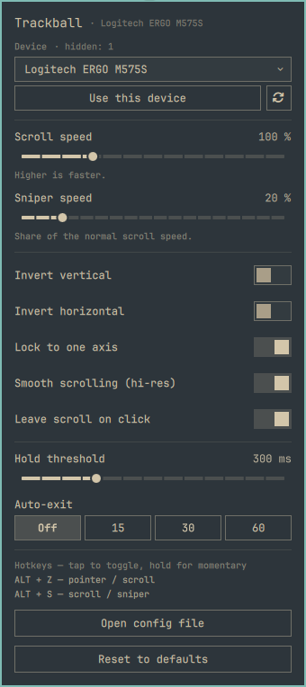
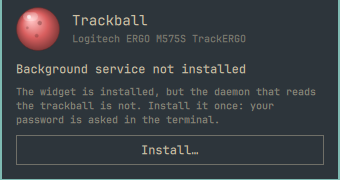
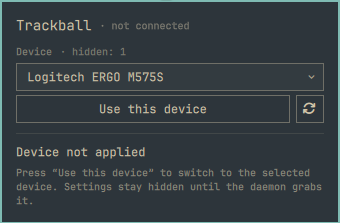
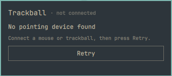

# Omarchy Trackball Scroll

Turn any trackball (or mouse) into a scroll wheel, with a slower "sniper"
mode, for [Omarchy](https://omarchy.org/). Press a key and the ball scrolls
instead of moving the cursor; a bar widget shows the mode and opens the
settings on right-click.

<p align="center">
  
</p>

## Features

- **Pointer / scroll / sniper** modes, toggled from the keyboard or the bar.
- **Tap or hold**: tap a hotkey to toggle and keep the mode, hold it for a
  momentary mode that ends when you let go.
- **Real scroll wheel events**: high-resolution `REL_WHEEL_HI_RES` plus classic
  `REL_WHEEL` clicks, so smooth scrolling works in modern apps and discrete
  clicks still work everywhere else. Horizontal scrolling is emitted too.
- **No latency in pointer mode**: the device is not grabbed at all until scroll
  mode is on. If the daemon dies, the kernel drops the grab.
- **Any pointing device**: the panel lists every mouse/trackball it finds and
  you pick the one to grab. Selection survives reboots.
- **Pretty device names**: udev vendor/model names, HID++ names for Logitech
  receivers.
- **Real settings UI**: speed, sniper speed, invert, axis lock, hi-res,
  leave-on-click, hold threshold, auto-exit, reset, open config.
- **English and Russian**, following the Omarchy language setting.

## Requirements

- Omarchy (Hyprland + the Quickshell bar).
- Arch `python-evdev` (the installer adds it if missing).
- Root once at install time: the daemon reads `/dev/input/event*` and creates a
  `uinput` device.

## Install

The repository **is** the plugin: `manifest.json` sits at the root, so Omarchy
can install and update it like any other plugin.

### As an Omarchy plugin (recommended)

```sh
omarchy plugin add https://gitlab.com/anton-borodavkin/omarchy-scrollmode.git --enable
```

The widget appears in the bar. Right-click it once: while the daemon is missing,
the panel shows a setup view with an **Install…** button.

<p align="center">
  
</p>

**Install…** opens a terminal with the bundled installer and asks for your
password there. The daemon and its systemd unit are installed, the service
starts, and within a second the widget switches to the normal settings view.
No commands to copy.

Why a terminal? Reading `/dev/input` and creating a `uinput` device needs root,
and a shell plugin runs as your user. The installer is the only privileged
step; the terminal shows exactly what runs. (`pkexec` is deliberately not used:
it needs a running polkit agent, which is not guaranteed on every desktop.)

The service lives outside the plugin, so after `omarchy plugin update` re-run
the installer once (from the plugin directory) if the daemon changed:

```sh
~/.config/omarchy/plugins/anton.scrollmode/install.sh
```

### From a checkout

The installer is also the manual path, and it installs both halves at once.

```sh
git clone https://gitlab.com/anton-borodavkin/omarchy-scrollmode.git ~/Projects/omarchy-scrollmode
cd ~/Projects/omarchy-scrollmode
./install.sh
```

The script elevates once (via `sudo` by default, or `SCROLLMODE_ELEVATE=pkexec
./install.sh`) and installs:

| Path | What |
| --- | --- |
| `/usr/local/lib/omarchy-scrollmode/scrollmoded.py` | the daemon |
| `/usr/local/bin/omarchy-scrollmode` | the CLI |
| `/etc/systemd/system/omarchy-scrollmode.service` | systemd unit |
| `~/.config/omarchy/scrollmode.json` | config (created once, never overwritten) |
| `~/.config/omarchy/plugins/anton.scrollmode/` | the plugin (manifest, widget, i18n) |
| `~/.config/hypr/bindings.lua` | one managed hotkey block |

## Usage

### Hotkeys

| Action | Keys |
| --- | --- |
| pointer ↔ scroll | `ALT + Z` |
| scroll ↔ sniper | `ALT + S` |

Both work two ways: a **tap** toggles the mode and keeps it, holding longer than
`hold_threshold_ms` (default 300 ms) engages the mode only while the keys are
held. Bindings use physical keycodes, so they work on remapped layouts
(Workman, Dvorak, …).

### Bar widget

| Action | Result |
| --- | --- |
| left click | pointer ↔ scroll (double click: scroll ↔ sniper) |
| right click | settings panel |
| dimmed icon | no pointing device is grabbed right now |

<p align="center">
  
</p>

### Settings panel

<p align="center">
  
</p>

Every control writes `~/.config/omarchy/scrollmode.json` through
`omarchy-scrollmode set` and the daemon reloads immediately. Sliders snap to
their step (5 % for speeds, 50 ms for the hold threshold).

Every action confirms itself: the button, slider title, toggle or auto-exit chip
flashes a green **✓ Done** for a moment, and "Reset to defaults" turns yellow
("Click again to reset") while it waits for the second click.

### Choosing the device

The **Device** dropdown lists every pointing device (a device with
`REL_X`/`REL_Y` and buttons). Pick one and press **Use this device**: the choice
is stored as `device.selected` and the daemon re-grabs it.

- Names come from udev (`ID_VENDOR` + `ID_MODEL`), from HID++ for a Logitech
  receiver, and fall back to the kernel name. Devices that are obviously
  keyboards (`keyboard`, `keypad`, `kbd` in the name/model) are skipped and
  counted in the "hidden" note next to the **Device** label.
- While `device.selected` is empty the daemon guesses: `device.match` (default
  `logitech`), then the first device that looks like a trackball, then the
  first pointer. This is only the initial guess.
- Moving the dropdown does **not** apply the device: settings stay hidden
  behind "Device not applied" until the daemon actually grabs it.
- If the chosen device disappears the panel says so and keeps the picker; it
  never silently switches to another mouse.

<p align="center">
  
</p>

With no pointing devices at all the panel only shows a notice and a Retry
button, and the bar icon is dimmed:

<p align="center">
  
</p>

## Configuration

`~/.config/omarchy/scrollmode.json`

```jsonc
{
  "device": {
    "selected": "",             // device id picked in the panel (empty = auto)
    "match": "logitech",        // initial guess while selected is empty
    "path": "",                 // pin an exact node, e.g. "/dev/input/event4"
    "exclude": ["omarchy-scrollmode"]
  },
  "hotkey": "ALT + Z",          // pointer <-> scroll
  "sniper_hotkey": "ALT + S",   // scroll <-> sniper
  "hold_threshold_ms": 300,     // longer hold = momentary instead of toggle

  "scroll": {
    "counts_per_notch": 85,     // ball counts per wheel notch; bigger = slower
    "sensitivity": 1.0,         // multiplier on top of counts_per_notch
    "sniper_multiplier": 0.20,  // sniper speed as a share of normal (0.20 = 20 %)
    "invert_vertical": false,
    "invert_horizontal": false,
    "axis_lock": true,          // a gesture stays on its dominant axis
    "axis_window_seconds": 0.25,
    "hi_res": true              // smooth scrolling; false = classic wheel clicks
  },

  "exit_on_click": true,        // any mouse button leaves scroll mode
  "auto_exit_seconds": 0,       // 0 = stay until toggled, otherwise idle timeout
  "hold_max_seconds": 60        // safety cap for a stuck momentary hold
}
```

`counts_per_notch` is the internal calibration. The panel shows it as a
percentage: `100 %` is the calibrated 85 counts/notch, `200 %` is twice as fast
(42–43 counts/notch). Sniping is shown as a percentage of the normal speed.

Apply changes without restarting anything:

```sh
omarchy-scrollmode reload   # re-read the config
omarchy-scrollmode hotkey   # rewrite the Hyprland bindings
```

## CLI

```sh
omarchy-scrollmode toggle        # pointer <-> scroll
omarchy-scrollmode sniper        # scroll <-> sniper (no-op in pointer)
omarchy-scrollmode on | off      # force scroll or pointer
omarchy-scrollmode status        # print the current mode
omarchy-scrollmode devices       # list pointing devices (active is marked *)
omarchy-scrollmode use <id>      # make a device the active one
omarchy-scrollmode rescan        # re-read the connected devices
omarchy-scrollmode set <path> <value>
omarchy-scrollmode reset         # restore the defaults
omarchy-scrollmode reload
omarchy-scrollmode hotkey [remove]
omarchy-scrollmode config        # print the config path
```

`set` validates keys and ranges, writes the JSON atomically and reloads the
daemon: `omarchy-scrollmode set scroll.counts_per_notch 60`.

## How it works

```
hotkey / bar click
        │
        ▼
omarchy-scrollmode (CLI) ──unix socket──▶ scrollmoded
                                            │ EVIOCGRAB only in scroll mode
                                            │ uinput "virtual pointer"
                                            ▼
                                    Hyprland and apps
                                            │
                     /run/omarchy-scrollmode/{state,status.json}
                                            │
                                            ▼
                              anton.scrollmode bar widget
```

- In pointer mode the device is not grabbed; libinput sees it exactly as
  before.
- Entering scroll mode grabs the event node and creates a `uinput` device that
  replays buttons and turns ball motion into wheel events. The original device
  goes silent while grabbed; releasing the mode closes the virtual device.
- Ball counts are accumulated in high-resolution wheel units (120 per notch),
  so no precision is lost, and discrete clicks are derived from the same
  accumulator.
- The axis lock keeps a gesture on its dominant axis; a clean direction change
  switches immediately, so vertical-then-horizontal scrolling works.
- Device names and the device list come from `/run/udev/data` plus HID++ 2.0
  `DeviceName` (`0x0005`) over the receiver's hidraw interface.

## Troubleshooting

**The icon does not change / the panel is stale.** The daemon recreates
`/run/omarchy-scrollmode` on restart; the widget re-reads its files every 1.5 s
and the unit keeps the runtime directory (`RuntimeDirectoryPreserve=yes`). If
needed, restart the shell: `omarchy restart shell`.

**The device is not listed.** `omarchy-scrollmode devices` shows the daemon's
view; `journalctl -u omarchy-scrollmode -f` shows why a node was skipped.
Keyboards (`keyboard`/`keypad`/`kbd` in the name) are hidden on purpose.

**The hotkey does nothing.** Re-apply the bindings (`omarchy-scrollmode hotkey`)
and check `hyprctl configerrors`. Bindings are physical keycodes, so changing
the keyboard layout does not break them.

**Scrolling feels too fast/slow.** Change the speed in the panel or
`scroll.counts_per_notch` (higher = slower); for sniper, `sniper_multiplier`.

**Emergency stop.** `sudo systemctl stop omarchy-scrollmode` — the grab is
released when the process exits.

## Files at runtime

```
/run/omarchy-scrollmode/state        pointer | scroll | sniper
/run/omarchy-scrollmode/status.json  devices, active id, hidden count
/run/omarchy-scrollmode/device       display name of the active device
/run/omarchy-scrollmode/control.sock CLI control socket (0600, user-owned)
```

## Development

```sh
python3 daemon/scrollmoded.py --selftest   # converter math
python3 tests/test_frame.py                # frame -> uinput path, tap/hold, clicks
omarchy plugin validate .                  # manifest + entry points
```

The repository layout:

| Path | What |
| --- | --- |
| `manifest.json`, `ScrollMode.qml`, `i18n/` | the Omarchy plugin, at the root so `omarchy plugin add` works |
| `daemon/scrollmoded.py` | the daemon |
| `daemon/omarchy-scrollmode` | the CLI |
| `config.default.json` | first-run config |
| `install.sh`, `uninstall.sh` | installer/uninstaller |
| `tests/` | offline tests |
| `docs/` | screenshots used by this README |

The GitLab CI job in `.gitlab-ci.yml` runs the Python tests and a syntax check
on the shell scripts. `omarchy plugin validate` needs Omarchy itself, so it is
part of the local checks rather than CI.

## Uninstall

```sh
./uninstall.sh
```

Removes the service, binaries, widget and the managed hotkey block. The config
in `~/.config/omarchy/scrollmode.json` is kept.

## Limitations

- A Logitech receiver exposes **one** evdev node for all devices paired to it.
  Several Logitech mice on the same receiver therefore appear as a single
  entry, and the daemon grabs them together.
- The keyboard filter is name-based; a keyboard whose descriptor does not
  mention "keyboard" may still show its pointer interface.
- Trackballs have no standard HID flag, so device detection is identity-based
  (the device you picked), not classification.

## License

MIT — see [LICENSE](LICENSE).
